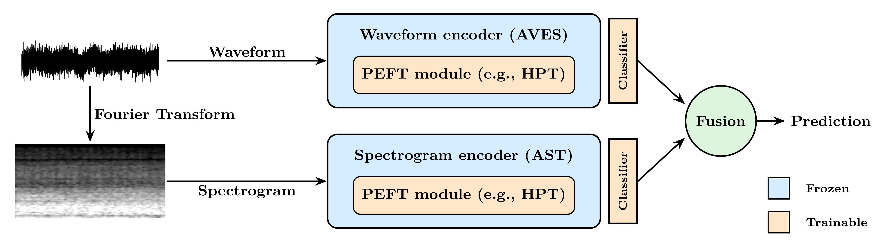

# Parameter-efficient Waveform-Spectrogram Fusion via Choquet Integral for Underwater Acoustic Classification
<p align="center">
  
</p>

Amirmohammad Mohammadi, Alexandra Van Dine and Joshua Peeples


## Installation Prerequisites

The [`requirements.txt`](requirements.txt) file includes the necessary packages, and the packages will be installed using:

   ```pip install -r requirements.txt```

A pre-configured environment with the essential packages already installed is available as well: [`environment.yml`](environment.yml)


## Demo

Run [`demo.py`](demo.py) in Python IDE or command line to train the models. 


## Inventory

```
└── root directory
    ├── demo.py                                // Entry point for training (Single/Dual modes)
    ├── datasets/
    │   ├── DeepShipDataModule.py              // Lightning DataModule for DeepShip audio dataset loader.
    │   └── ShipsEarDataModule.py              // Lightning DataModule for ShipsEar audio dataset loader.
    ├── src/
    │   ├── model_module.py                    // LightningModule wrapper around HF models (Single mode)
    │   ├── multiencoder_module.py             // Dual-branch LightningModule wrapper (Dual mode)
    │   ├── audio_augmentation.py              // Ship-specific and waveform augmentations (SpecAugment, SNR noise)
    │   ├── audio_filtering.py                 // Feature extraction transforms (Mel, MFCC, CQT, VQT) and normalization
    │   ├── hpt.py                             // HPT integration
    │   ├── RBFHistogramPooling.py             // HistogramLayer (RBF histogram)
    │   ├── adapters.py                        // Parallel Adapters and integration
    │   └── callbacks/
    │       ├── hpt_gate_logger.py             // Callback to log per-epoch HPT gate values.
    │       └── print_epoch_losses.py          // Callback to print epoch train/val loss summaries.
    └── utils/
        ├── metrics.py                         // aggregate_and_save: aggregates per-run metrics.
        ├── profiling.py                       // Standalone profilers (FLOPs, latency, throughput).
        └── run_evaluation_plots.py            // Evaluation plotting.
```

## License

This source code is licensed under the license found in the [`LICENSE`](LICENSE) file in the root directory of this source tree.

This product is Copyright (c) 2025 A. Mohammadi, A. Dine and J. Peeples. All rights reserved.


